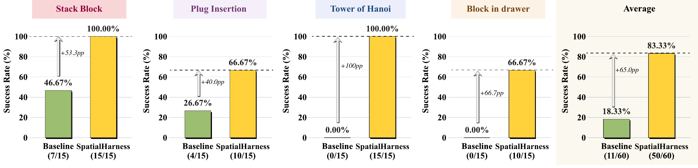
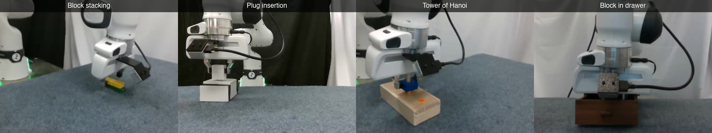

<h1> SpatialHarness: Test-Time Spatial Scaffolding for Fine Robotic Manipulation</h1>

**Jiayu Wang1, Yue Yu1, Bin Zhu2, Zhiyao Yang3, Jingjing Chen3,†**

1 College of Computer Science and Artificial Intelligence, Fudan University 
2 Singapore Management University 
3 Institute of Trustworthy Embodied AI, Fudan University 
† Corresponding author

  
  
  

## Problem and Motivation

Multimodal robot policies still struggle with fine manipulation, where success depends on precise spatial relationships such as plug–socket alignment or gripper–handle contact. Fixed camera views can obscure these relationships, leaving an otherwise capable policy without enough evidence to act reliably.

**Can we improve spatial observability at test time without retraining the policy or changing the physical camera setup?** SpatialHarness addresses this question by supplying additional views and spatial context that make task-critical geometry easier to assess.

## Method Overview

At test time, SpatialHarness maintains a simulated scene synchronized with real-world execution and uses it to provide the policy with additional spatial information.

Before execution, the system starts from the task's success conditions and identifies the spatial relationships that must be assessed for success. It works backward from these relationships to determine virtual viewpoints that can reveal them. During execution, it continuously updates the scene using measured robot motion and real-world observations. The frozen multimodal policy receives rendered images from the additional viewpoints, object poses, and rendering reliability information. The policy combines these inputs with its existing real-world observations to generate actions, forming a continuously updated closed loop.

## Experiment Results

We evaluate SpatialHarness on four real-robot tasks: **block stacking, plug insertion, Tower of Hanoi, and block in drawer**. Both methods use GPT-6 Astra (low reasoning effort) as the policy model, with the same physical camera configuration and control protocol. Each method is evaluated over 15 trials per task. Each trial consists of 20 interaction rounds.

With SpatialHarness, the average success rate across the four tasks increases from **18.33% to 83.33%**. The success rate for plug insertion increases from 26.67% to 66.67%, while that for Tower of Hanoi increases from 0% to 100%. These results indicate that improving spatial observability at test time can help the same multimodal policy perform fine manipulation more reliably.

### Success Rates

15 trials per task and method; 120 trials in total. Figure 4 from the paper. Arrows indicate improvements in percentage points.

### Task Demonstrations

<!-- Overview video: replace the linked poster below with the URL generated by GitHub's video attachment uploader to embed a player. -->

Excerpts from four tasks. Click the preview to watch the overview video.

[Explore more demos ↗](https://emilia113.github.io/SpatialHarness/) · [Full Results ↗](https://huggingface.co/datasets/yzy05/SpatialHarness)
